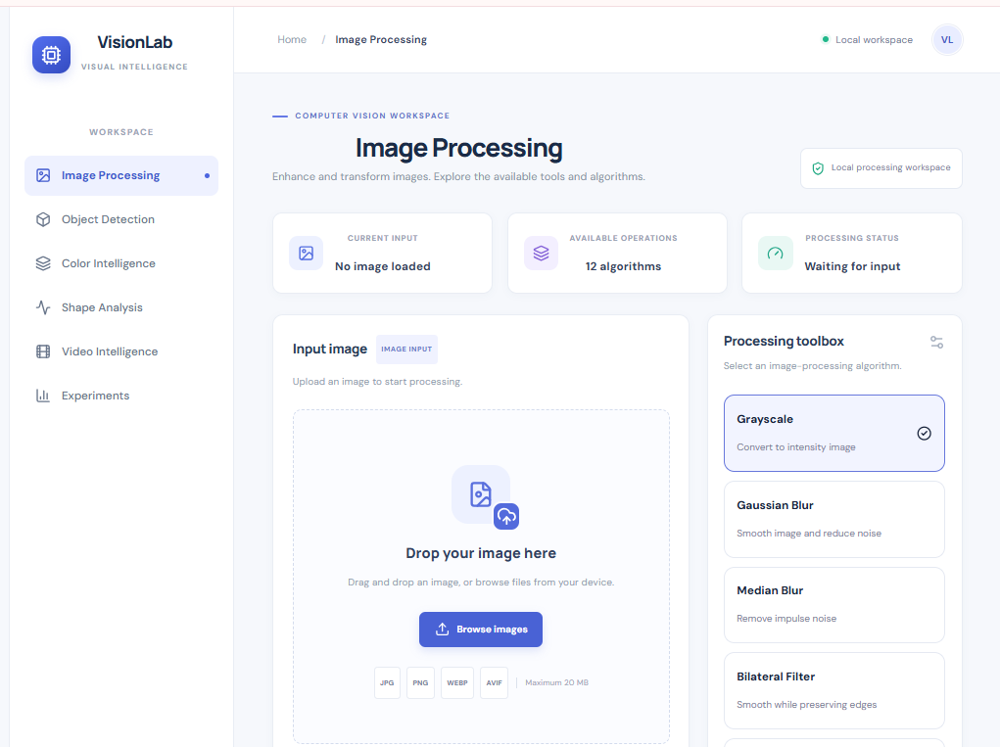
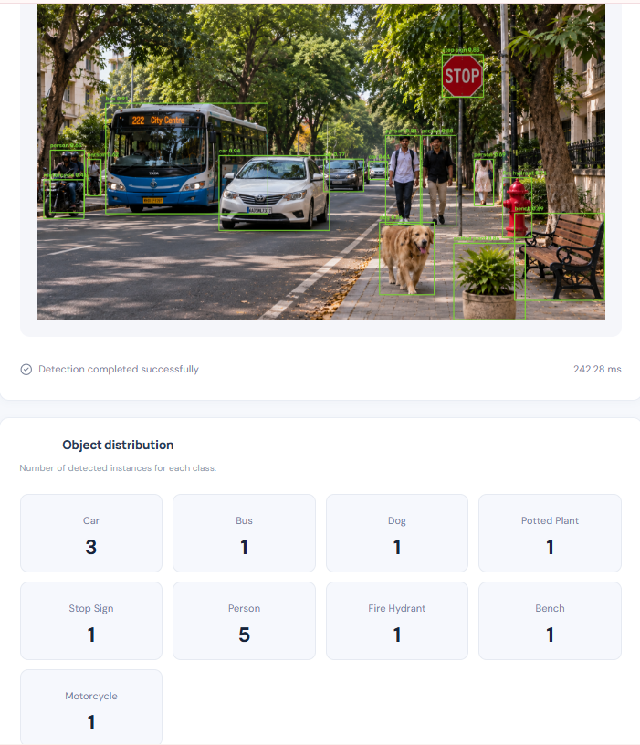

# VisionLab 🔬

My first hands-on project in Computer Vision, built as part of my journey of learning Python, OpenCV, and AI.

VisionLab is a web application that brings together different computer vision techniques in one place. It allows users to upload images and videos, experiment with image-processing algorithms, analyze colors and shapes, and explore object detection.

## Features

- **Image Processing:** Grayscale, blurring, edge detection, sharpening, thresholding, histogram equalization, rotation and flipping.
- **Color Analysis:** Dominant color extraction, RGB/HSV/LAB analysis and color segmentation.
- **Shape Analysis:** Detect geometric shapes and examine their properties.
- **Object Detection:** Detect common objects in images using YOLO11n.
- **Video Analysis:** Analyze sampled video frames using object detection.
- **Algorithm Experiments:** Compare the outputs and processing times of different image-processing algorithms.

## Screenshots

### Main Dashboard



### Object Detection



## Built With

- Python
- OpenCV
- FastAPI
- NumPy
- ONNX Runtime
- YOLO11n
- React
- TypeScript
- Vite

## Running Locally

### Backend

```bash
python -m venv .venv
.venv\Scripts\activate
pip install -r requirements.txt
cd backend
uvicorn main:app --reload
```

Backend API documentation: http://127.0.0.1:8000/docs

### Frontend

Open another terminal:

```bash
cd frontend
npm install
npm run dev
```

Open the local address displayed by Vite.

## Project Structure

```text
VisionLab/
├── assets/
│   └── screenshots/
│       ├── dashboard.png
│       └── object-detection.png
├── backend/
│   └── main.py
├── frontend/
│   ├── public/
│   └── src/
├── models/
│   └── yolo11n.onnx
├── requirements.txt
└── README.md
```

## What I Learned

While building this project, I explored:

- Image processing using OpenCV
- Working with images and video frames
- Building APIs using FastAPI
- Integrating a machine learning model using ONNX Runtime
- Connecting a React frontend with a Python backend
- Comparing different image-processing techniques

## About This Project

This is my first computer vision project, and it represents the beginning of my journey into Computer Vision, AI, and Robotics.

I'm looking forward to learning more, experimenting with new ideas, and building more advanced projects.

**More experiments and projects to come!** 🚀